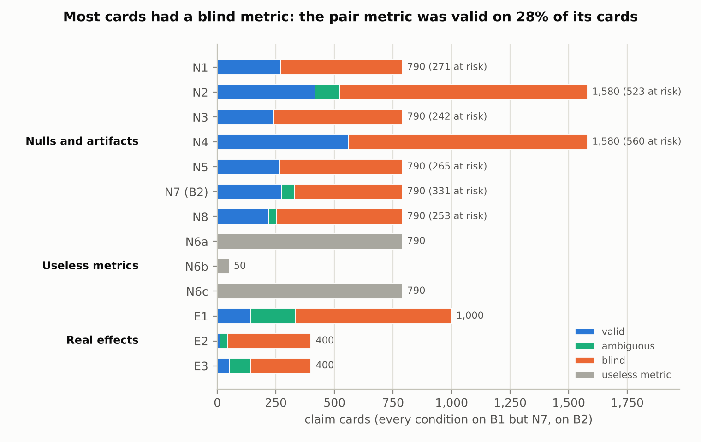
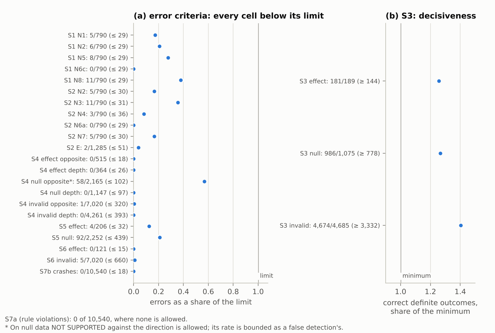
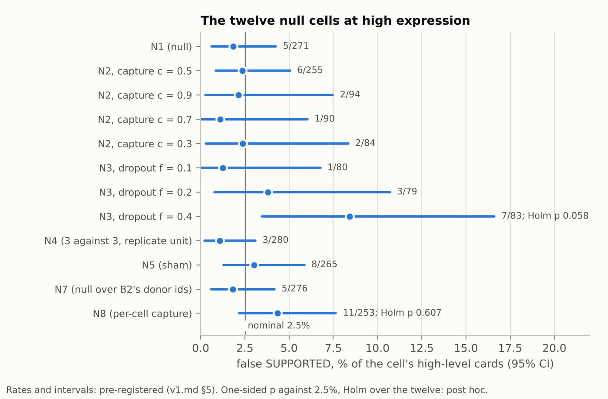
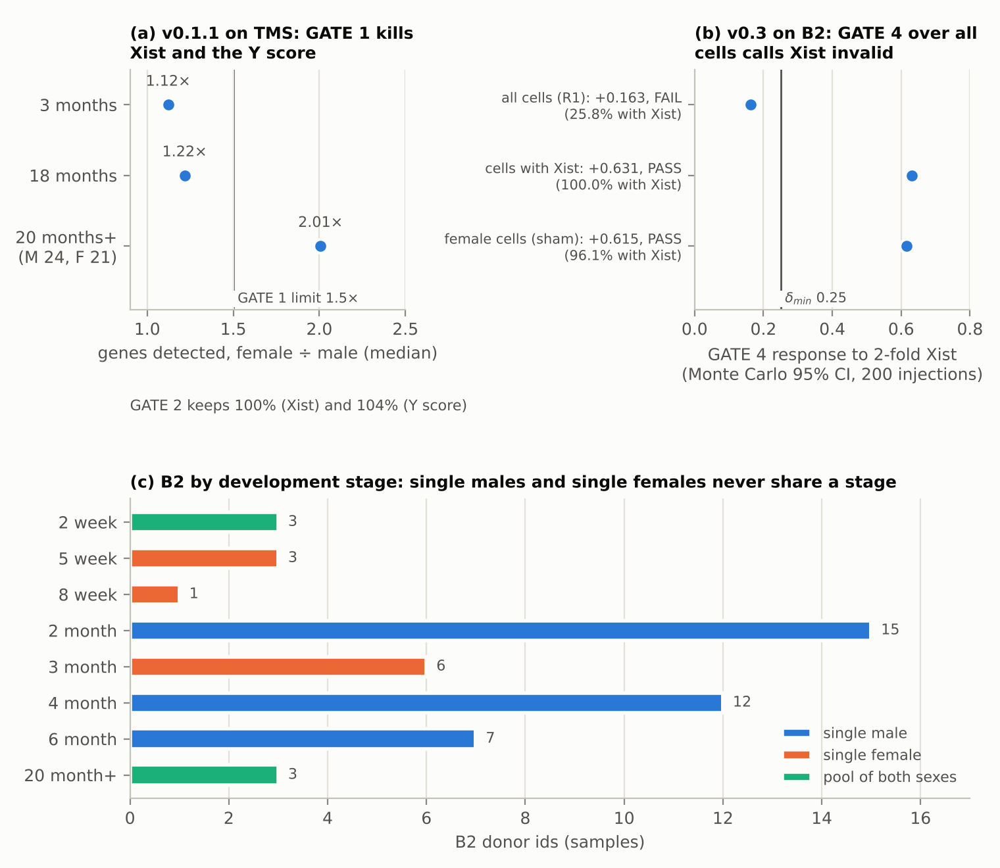
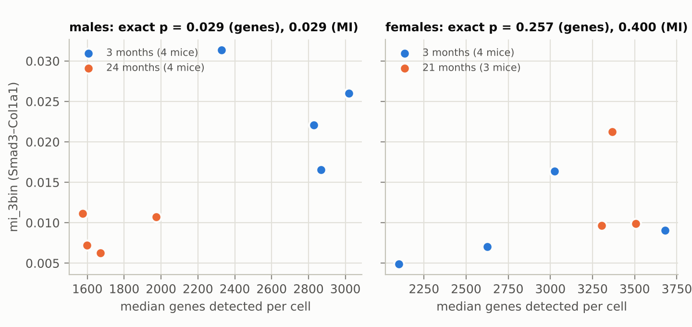

# Validating the validator: a blind, pre-registered test of artifact checks on one single-cell metric

Theodor Spiro | ORCID 0009-0004-5382-9346

## Abstract

Single-cell metric differences are often read as biology, though depth, dropout or design can
produce them. metric-autopsy tests a pre-registered claim with gates aimed at named artifacts
and returns one verdict from metric validity, design adequacy, a replicate-level effect at equal
depth, and replication. Its first release passed a random-number metric and blocked a known sex
difference on its own probes. I rebuilt it (v0.3), froze it and tested it blind against truth
planted into real CELLxGENE counts: 10,540 claims on one metric (log-normalized Pearson
correlation of a gene pair) and on useless metrics, all on human oligodendrocytes but one null
on mouse islets. Effect-size thresholds and probe doses came from a pilot that knew the truth.
v0.3 passed all eight pre-registered criteria; no useless metric was SUPPORTED (0/1,630), and my
prediction that per-cell variable capture would break it was not confirmed (11/790 false
SUPPORTED; limit 29). But the metric was valid on only 28% of its claims, all at high expression
(a pre-registered secondary outcome). By a post-hoc power check, the key criterion was 95%
likely to fail only if 14–15% of a null's claims at risk (metric valid or ambiguous) were
falsely SUPPORTED; at risk, per-cell capture gave 4.3% (95% CI 2.2–7.6%; nominal 2.5%). The one
real positive control expected to succeed (Xist and Y genes, female versus male mouse islets;
run after the panel) failed. Diagnosed afterwards: donor IDs were samples, six pooling both
sexes, and single-sex samples never shared a stage, which the protocol missed; and GATE 4
measured an injected Xist signal over all cells, 74% lacking Xist, calling a valid metric
invalid. v0.3 confirmed no real biological difference. Validators need blind tests on real data,
positive controls checked before registration, and user-chosen settings. Code, protocol and
verdicts are open.

## 1. Introduction

The workflow behind many single-cell findings is short. A metric, such as a mutual information,
a correlation or an entropy, is computed in two groups of cells; the numbers differ; a sentence
about biology follows. Nothing in that workflow asks whether the metric could have moved for a
reason that is not biological: sequencing depth, dropout, a batch, or a design in which the
groups differ in more than the claim says. I call it "compute, then believe". Three of my own
analyses failed this way before this project began (an entropy anticorrelation, an exponent of
the electrocardiogram and a mutual information in Tabula Muris Senis, Tabula Muris Consortium
2020; only the last has a script behind it, the audit in Appendix B).

metric-autopsy turns the inversion of that workflow into a runnable sequence of gates: state the
commitments, red-team the metric, then believe. §2 shows how its first release failed its own
probes, §3 describes the rebuilt version, and §4 reports a blind, pre-registered validation of
it against truth planted in real data; Appendix B audits the claim that started the project. The
validation passed its criteria within a narrow scope, and §4 states what the pass excludes.

## 2. v0.1 and how it failed its own probes

Before the rework I wrote probes: small simulations with a known truth, each aimed at one way a
gate can err (`validation/probes/`, at the tag). The released v0.1.1 erred in both directions
(Table 1).

**Table 1.** Three of v0.1.1's failures on its own probes (`validation/probes/README.md`,
`baseline_v0.1.1.log`).

| Probe | Truth | v0.1.1's verdict | Why |
|---|---|---|---|
| p01 | a metric that returns random numbers | "PASS — cleared 3 auto gates" | GATE 0 tested invariance only, and no gate asked for a response to a signal |
| p04 | Xist is higher in female cells (demo data) | FAIL at GATE 1: one stratum had a 2.00× gap in genes detected | GATE 1 was a kill switch, although GATE 2 kept 100% of the effect under matching |
| p07 | 3 against 3 mice, no age effect | "effect survives matching" in 22 of 40 runs | the permutation unit was the cell, not the mouse |

An exact test over p07's mice found an effect in none of the 40 runs, but its design guarantees
that: with 3 against 3 the smallest attainable two-sided p is 2/20 = 0.10. The probes recorded
18 such failures as strict expected failures. They are a development set: they found the bugs
and the fixes were built against them, so they carry no confirmatory weight.

## 3. How v0.3 works

**Table 2.** Terms.

| Term | Meaning |
|---|---|
| claim card (card) | one pre-registered claim on one dataset, run once through the engine |
| SESOI | the smallest effect size of interest, on the metric's scale: an effect shown within ±SESOI counts as absent |
| δ_min | the smallest response to an injected signal that matters, 0.5 × SESOI |
| TOST | two one-sided tests (Schuirmann 1987), which show an effect within ±SESOI |
| CP10k | a gene's counts per 10,000 of the cell's counts |
| definite outcome | a verdict that decides the claim: SUPPORTED, NO DETECTABLE EFFECT, a NOT SUPPORTED other than GATE 0's (Table 3), DEGENERATE METRIC, UNIDENTIFIABLE |
| oracle | the validation's code that knows the planted truth and never imports the engine (`oracle.py`); it ran the pilot that set the SESOI and GATE 4's dose |
| valid, blind, ambiguous | the oracle's truth about the metric on a gene pair: its population response to GATE 4's injection is at least 1.2 δ_min, at most 0.8 δ_min, or in between |
| useless metric | a random number (N6a), a constant (N6b) or a score of random genes (N6c) |
| establishable | a case (condition, variant and pair) on which the oracle reaches a correct definite outcome with power ≥ 0.9 in the pilot |
| S3's strata | effect: a real effect with a valid metric; null: a null with a valid metric; invalid: a blind or useless metric, where "metric invalid" is the correct outcome; N3 and N8 are in none |
| saturation dose | per background and level, the smallest dose of the grid 0.25–4.0 whose mean response reaches 95% of the grid's maximum |
| at risk | a card whose metric is valid or ambiguous, where a false SUPPORTED needs no error of GATE 4 or 5 first |

**Table 3.** The verdicts of `report.decide`. It tests a degenerate or invalid metric first,
then the design, then the effect; INCONCLUSIVE comes wherever the evidence stops.

| Verdict | When |
|---|---|
| DEGENERATE METRIC | the metric never varies |
| NOT SUPPORTED: metric invalid | GATE 0 finds a nuisance bias above its tolerance (in the validation a "refusal": allowed, never definite), GATE 4 shows the metric blind to the injected signal, or GATE 5's controls fail |
| UNIDENTIFIABLE | the estimand's correction is impossible (a content claim without spike-ins), or the replicates are partially crossed with the groups |
| NOT SUPPORTED: explained by depth | a raw difference vanishes at equal depth |
| INCONCLUSIVE | among others: two or fewer replicates per group; an effect neither detected nor shown absent; a metric whose response is untested; judgment questions unresolved |
| NO DETECTABLE EFFECT | TOST shows the effect within ±SESOI, and the metric's response is shown |
| NOT SUPPORTED: opposite direction | an effect detected against the pre-registered direction |
| NOT SUPPORTED: not replicated | GATE 6 does not replicate the effect |
| SUPPORTED | an effect detected in the pre-registered direction by a metric whose response is shown, with the judgment questions resolved; "provisional" until GATE 6 replicates it |

v0.3, the package `metric_autopsy` at the tag `v0.3.0-prereg` (`src/`, git tree 97cbab3c…),
decides a verdict from four fields by one rule, `report.decide`, with its cause
(`report.decide_cause`), which the Python API, the command-line tool and the MCP server (through
which an AI agent calls the engine) share. The gates take a black-box `metric(data) -> float`:
- **Metric validity.** GATE 0 perturbs the user's own data (extra dropout, depth halved, library
  sizes scaled) and compares each shift of the metric with a null without gene–gene structure. A
  nuisance *bias* that the declared correction removes (depth, under thinning) is reported; any
  other bias fails when it and its 95% lower bound exceed 0.5 × SESOI; *attenuation* is reported
  and feeds the power check. GATE 4 injects a known change 200 times by binomial thinning, each
  against a matched sham without the signal: a coupling of two genes, or a module that raises
  some genes 2-fold in a random share of cells (`frac`, default 0.3) by thinning every other
  gene, against a sham that thins every gene. It fails when the upper 95% bound of the mean
  response, over the injections into the one dataset, is below δ_min, passes when the lower
  bound is above 0, and is untested otherwise. GATE 5 compares the controls with empirical nulls
  of matched expression or depth, in every stratum.
- **Design adequacy.** Whether the pre-registered estimand's correction is possible on these
  data, and how many biological replicates each group has. GATE 1 compares the groups' genes
  detected in every stratum of the declared factors, with bootstrap intervals and a Bonferroni
  correction; it warns, and stops only when no stratum holds both groups.
- **Effect.** GATE 2 thins the deeper group binomially, by one common ratio within each stratum,
  to equal depth for a composition claim or to equal spike-in capture for a content claim;
  without spike-ins a content claim is UNIDENTIFIABLE. The effect is then inferred over the
  replicates, nested in the groups or paired within them: an exact or Monte Carlo permutation
  test with at least four per group, a t interval marked "parametric only" with three, and no
  verdict with two or fewer. NO DETECTABLE EFFECT needs TOST within ±SESOI.
- **Replication.** GATE 6 re-estimates the effect on independent data.

GATE 3 and GATE 7 enter no field. GATE 3 exports the raw scatter of the two groups for a person
to look at. Two judgment questions hold the verdict at INCONCLUSIVE until the pre-registration
resolves them: which other scenarios could move the metric (a review that goes with GATE 4,
apart from its injection test) and whether the effect is large enough to matter (GATE 7, whose
answer is the pre-registered SESOI). An invalid metric stops the analysis. The
pre-registration's hash is in every report, and a run log counts the attempts at one claim.

On the development set v0.3 gave a verdict outside the allowed set on 1 of 190 cases, a false
SUPPORTED on 1 of 150 nulls, artifacts and useless metrics, and a definite verdict on 130 of 150
establishable cases, 129 of them correct (`validation/probes/verdicts_v0.3.0.dev0.log`). These
numbers carry no confirmatory weight either.

## 4. A blind, pre-registered validation of v0.3

### 4.1 Design

The engine was frozen as the tag `v0.3.0-prereg` (commit 90a7718) together with the protocol
(`validation/prereg/v1.md`). One workflow run executed the protocol from the tag, in one attempt
(workflow run 37990113304). The records it fixed before drawing the key are the run tag
`panel-v1-run` (commit 7782254). The key that chose the gene pairs and the claim cards was the
randomness of round 32929913 of drand's quicknet, a public beacon whose rounds are threshold
signatures of independent operators (drand 2023), published after those records (Appendix A).

**Backgrounds.** A rule fixed in advance chose two backgrounds from the CELLxGENE Census
(release 2025-11-08; CZI Cell Science Program et al. 2025):
- **B1:** human oligodendrocytes of the MSSM cohort; nuclei, 10x 3' v3. It carried every
  condition but one: 8,960 datasets and 9,750 cards.
- **B2:** mouse pancreatic islet beta cells (Hrovatin et al. 2023); cells, 10x 3' v2 (39 of its
  50 donor ids) and v3 (11). It carried only the null N7 (790 cards) and the anchor R1. Its
  donor ids are samples: 6 of them are pools of both sexes, and all single females are of the
  NOD strain (§4.5). The assays come from the Census metadata (`census_metadata.log`, workflow
  run 38122733079).

**Claims.** Each card states what a user pre-registers: the estimand (composition), the
direction, the replicate unit (the donor) and the SESOI on the metric's observed scale, with
δ_min = 0.5 × SESOI. Each card passed the engine the SESOI of its background and level and the
dose of GATE 4's injected coupling, the saturation dose of that background and level, both set
by a pilot before the key (Table 4). A user sets them without a pilot.

**Table 4.** The pilot's settings (`pilot.json` in the run tag; `v1_pilot_table.log`). Δ* is the
real effect's population size at the base dose, defined on B1 only.

| Background | Level | SESOI | Saturation dose | Δ* at the base dose |
|---|---|---|---|---|
| B1 | high | 0.255 | 2.5 | 0.258 |
| B1 | medium | 0.320 | 2.75 | 0.065 |
| B1 | low | 0.355 | 3.0 | 0.047 |
| B2 | high | 0.250 | 3.25 | — |
| B2 | medium | 0.265 | 2.25 | — |
| B2 | low | 0.370 | 2.0 | — |

**Planted truth.** Truth was planted into the backgrounds' real counts by binomial thinning
(Gerard 2020). Each background holds 24 gene pairs, the 8 most correlated disjoint pairs at each
of three expression levels. The one metric is the log-normalized Pearson correlation of a pair.
The conditions (Fig. 1):
- **Nulls** (N1–N8): donor-label permutation (N1); N1 with capture loss in one group (N2, four
  steps c) or with entry-level dropout, a share f of one group's detected entries set to zero
  (N3, three steps); pseudoreplication, 3 against 3 donors (N4); a within-donor sham (N5);
  useless metrics (N6a–c); a label permutation over B2's donor ids (N7), a null at the level of
  the id, not of the mouse; and N1 with capture that varies from cell to cell (N8), outside the
  engine's correction family.
- **Real effects** (E1–E3): a coupling of the pair injected in one group (E1, at 0.25, 0.5, 1
  and 1.5 times a base dose), alone or with a capture loss against it (E2) or with it (E3).

The base dose was to be the key dose: the smallest dose at which the oracle detects E1 with
power ≥ 0.9 and Δ* is at least 1.25 × SESOI. No level had one (at the high level the largest
power was 0.85), so E1–E3 ran at the saturation dose. At the high level Δ* at that dose, 0.258,
is about the SESOI, 0.255; at the medium and low levels it is 0.20 and 0.13 of it.

In all there are 9,750 datasets and 10,540 cards.

**Criteria.** Eight criteria (S1–S7b; Table 5) were each sized by one principle (§7.2). Three
anchors on real data whose truth is public (R1–R3) were reported one by one, not pooled into
rates.

### 4.2 Result

v0.3 passed all eight criteria (Table 5; `scores.txt`, branch `results/panel-v1`, commit
adc7d65; Fig. 2).

**Table 5.** The criteria.

| Criterion | What it counts | Count | Limit |
|---|---|---|---|
| S1 | false SUPPORTED on each key null (N1, N2 at c = 0.5, N5, N6c, N8) | N1 5, N2 6, N5 8, N6c 0, N8 11 (of 790 each) | ≤ 29 each |
| S2 | false SUPPORTED in the other null groups and on the real effects | N2's other steps 5, N3 11, N4 3, N6a 0, N7 5 (of 790 each); real effects 2 of 1,285 | ≤ 30, 31, 36, 29, 30; ≤ 51 |
| S3 | correct definite outcomes on establishable cards, per stratum and condition | real effects 181/189, nulls 986/1,075, invalid metrics 4,674/4,685; 16 of 16 conditions | ≥ 144, 778, 3,332 |
| S4 | false NOT SUPPORTED against the direction and explained by depth; on nulls against the direction is allowed, but bounded as a false detection | real effects 0/515, 0/364; nulls 58/2,165 (against the direction), 0/1,147; invalid metrics 1/7,020, 0/4,261 | ≤ 18, 26; 102, 97; 320, 393 |
| S5 | false "metric invalid" on a valid metric | real effects 4/206, nulls 92/2,252 | ≤ 32, 439 |
| S6 | false NO DETECTABLE EFFECT | real effects 0/121, invalid metrics 5/7,020 | ≤ 15, 660 |
| S7a | verdicts the engine's rules cannot give | 0 of 10,540 | 0 |
| S7b | crashes | 0 of 10,540 | ≤ 18 |

No useless metric was SUPPORTED: 0 of 1,630 cards, 790 with random numbers (N6a), 50 with a
constant (N6b) and 790 with a score of random genes (N6c), a pre-registered per-truth rate. I
had predicted that v0.3 would fail S1 on N8, since per-cell variable capture is outside its
correction. The prediction was not confirmed: 11 false SUPPORTED of 790, where S1 allows 29. Its
second part, that N8's answers against the direction might fail S4's null cell, was not
confirmed either: that cell held 58 of 2,165 (limit 102), 11 of them N8's
(`validation/exploratory/v1_null_cells.log`).

**What the pass excludes** (a power check made after the results; `v1_null_cells.log`). A false
SUPPORTED needs a metric that responds: on a blind metric GATE 4 usually stops the analysis
first. No blind card at the medium or low level was SUPPORTED (§4.3), and of the 97 blind cards
at the high level 2 were, both real effects. In each key null of the pair metric only 253–271 of
the 790 cards had a valid or ambiguous metric, all at the high level (Fig. 1). On these cards at
risk a key null's cell fails with probability 0.95 only at a false-SUPPORTED rate of 14.3–15.3%
among them, and a validator wrong on 5% of them passes with probability 1.00, one wrong on 7.5%
with 0.98–0.99 (Table 6; S2's cells in Appendix C). The pilot had shown the mix before the key:
a valid metric on 2,453 of the 8,910 expected pair-metric cards. At the error rates the pilot
measured, a sound validator, which on N3 and N8 has the oracle's true correction, passes the
criteria together with probability 1.000 (`oc_pilot.log`); that is a property of the criteria,
not a prediction for the engine. The pass therefore excludes only gross excesses of false
SUPPORTED on the pairs where the metric works.

**Table 6.** S1's cells on the cards at risk (computed after the results; `v1_null_cells.log`).

| Cell | Cards | At risk (valid / ambiguous) | Limit | Limit as a share at risk | Fails with P 0.95 at | Passes at 7.5% with P |
|---|---|---|---|---|---|---|
| S1 N1 | 790 | 271 (271 / 0) | 29 | 10.7% | 14.3% | 0.978 |
| S1 N2 | 790 | 255 (182 / 73) | 29 | 11.4% | 15.2% | 0.990 |
| S1 N5 | 790 | 265 (265 / 0) | 29 | 10.9% | 14.6% | 0.984 |
| S1 N8 | 790 | 253 (221 / 32) | 29 | 11.5% | 15.3% | 0.991 |

### 4.3 Error rates by level and truth

The per-condition, per-level and per-truth rates are pre-registered secondary outcomes (v1.md
sections 5 and 7), not criteria (`validation/exploratory/v1_by_level.log`, from `scores.json`),
with 95% Clopper–Pearson intervals (Clopper & Pearson 1934).
- On these backgrounds the metric is valid only at high expression: all 2,458 cards with a valid
  metric are at the high level, 28% of the 8,910 cards on the pair metric (Fig. 1). At the
  medium and low levels the metric is blind (55 medium-level cards of N7 are ambiguous), and no
  card there was SUPPORTED (0 of 6,988).
- In the twelve null cells at the high level (Fig. 3; `v1_null_cells.log`), after Holm's
  correction over the twelve no cell differs from the nominal 2.5%; without the correction, N3
  at f = 0.4's interval excludes it. The two largest are N3 at f = 0.4, 7/83 = 8.4% (95% CI
  3.5–16.6%; one-sided p against 2.5% 0.0048, after Holm 0.058), and N8, 11/253 = 4.3%
  (2.2–7.6%; 0.055, after Holm 0.61); both tests were decided after the results. N8 plants
  capture that varies from cell to cell, which v1.md places outside the engine's correction
  family. N3 plants entry-level dropout, inside v1's binomial-thinning family, but its true
  correction, which the oracle applies, is one the engine cannot have (v1.md section 6). Both
  are hypotheses for v0.4 with a mechanism, not measured defects.
- GATE 0 refused 31 cards, all on N7, the null on B2: 26 of its 276 high-level cards (9.4%, 95%
  CI 6.2–13.5%) and 5 at the medium level. GATE 0 refuses where extra dropout would bias the
  metric beyond its tolerance, as it is built to, and a refusal is allowed, never definite. But
  these data were null, with no difference in dropout between the groups, and the refusals cost
  decisiveness: S3's N7 cell had 204 correct definite outcomes of 237, fewer than the other
  nulls' (N1 250 of 271, N2 346 of 364, N5 186 of 203; `v1_null_cells.log`). Appendix C gives
  the pairs and the tests of chemistry and depth, decided after the results.
- Decided after the results: N8 and N3 at f = 0.4 were singled out as the two largest rates; on
  N8's 221 high-level cards with a valid metric, 8 were falsely SUPPORTED, 3.6% (95% CI
  1.6–7.0%; `v1_nulls_by_truth.log`); the pure nulls N1, N5 and N7 pooled gave 18/812 = 2.2%
  (1.3–3.5%) at the high level; and counting the answers against the direction too, N8 gave
  22/253 = 8.7% at a nominal 5%.

The development probe p16 had given N8 a false SUPPORTED on 18 of 160 simulated datasets (11.3%;
`validation/probes/p16_variable_capture_n8.log`). Over all levels that is 8.1 times N8's 11/790.
On the datasets at risk p16's rate is at most 16.1%, if all 18 errors fell on its 112 datasets
with a valid metric (p16 does not record where they fell), so at most 3.7 times N8's high-level
rate (decided after the results; `v1_by_level.log`). p16 also ran with a SESOI of 0.1 and a dose
of 2.0, where B1's high level had 0.255 and 2.5.

### 4.4 Limitations

- **The scope** is one metric, the log-normalized Pearson correlation of a gene pair, on the 8
  most correlated pairs per level; one human background for every condition but N7; and the
  artifacts N2, N3 and N8 (capture loss, entry-level dropout and capture that varies from cell
  to cell). Nothing else is validated, `mi_3bin` (the mutual information of a gene pair on a
  three-bin discretization, the metric of the v0.1.1 preprint) included.
- **The real effects.** Of their 1,800 cards, 206 had a valid metric and 309 an ambiguous one,
  all at the high level, and 1,285 a blind one. 189 of the 206 with a valid metric were
  establishable and 121 at or above the SESOI: S3's effect stratum and S5's and S6's effect
  cells rest on these 121–206 cards. All 1,285 with a blind metric were establishable too, with
  "metric invalid" as the correct outcome (S3's invalid stratum: E1 668, E2 358, E3 259;
  `v1_pilot_table.log`).
- **N2 did not test the correction of depth.** The oracle's power to detect N2's raw difference
  at c = 0.5 was 0.21, 0.14 and 0.16 at the three levels, never the 0.9 at which v1.md calls N2
  informative (`informative_levels` is empty).
- **Not tested.** GATE 6 never ran (no card had a second dataset), so the replication field was
  not tested and every SUPPORTED on the panel is provisional. The cards declared the judgment
  questions resolved. The content estimand was tested only in R2.
- **The settings came from the oracle.** The SESOI and GATE 4's dose came from the pilot on
  every card (Table 4). A user sets both without a pilot.
- **The truth about the metric is circular.** A metric is valid when it responds to the
  injection that GATE 4 itself uses. S5 therefore measures GATE 4's sampling error, and v1 could
  not have found a probe built the wrong way; R1's was one (§4.5).
- **v0.3 corrects neither capture that varies from cell to cell nor entry-level dropout.** Its
  correction of depth brings whole groups to one depth.
- **Design effects.** Because datasets share donors, the intervals at the effective sample size
  n / deff (Korn & Graubard 1998) are wider than the binomial ones. The design effect exceeds
  1.5 only for S3's null stratum (4.74; its rate 0.917, 95% CI 0.873–0.950), S3's invalid
  stratum (5.62; 0.998, 0.991–1.000), S5's null cell (5.28; 0.041, 0.024–0.064) and S3's E1
  condition (1.54; 0.972, 0.913–0.995): beyond the backgrounds' donors these rates are known
  less precisely. In the false-SUPPORTED cells it is at most 1.055, but at N5's 1.055 S1's cell
  passes a doubled error with probability 0.051, just above the principle's 0.05
  (`v1_null_cells.log`).
- **GATE 4's module probe measures the response over all cells.** For a metric that is a mean
  over cells this is, by identity, the share of cells with the marker times the response in
  them, and for a well-detected marker that response is below ln 2. The module's default raises
  the marker 2-fold in 30% of cells, so its response is at most 0.3 × ln 2 = 0.208, below δ_min
  0.25 at a SESOI of 0.5: a valid mean-expression metric of a well-detected gene cannot pass
  GATE 4 with the default (by arithmetic, `gate4_module_analytic.log`; by simulation, at most
  +0.206 on synthetic counts and +0.191 on B2's Xist cells, `gate4_module_dilution.log`). On
  shallow data the probe can pass for the wrong reason. At 2,000 counts per cell it passes a
  marker of single counts (+0.358 simulated), but of the 0.360 its arithmetic gives the 2-fold
  change makes 0.182 and the sham's loss of the single counts 0.178: the sham thins the marker,
  the injection does not. v1 put no valid metric through the module probe (only the useless
  N6c), so the panel could show neither. The command-line tool and the MCP server offer only the
  coupling probe.

### 4.5 The anchors

R2 compares mouse embryonic stem cells sorted by DNA content (B3; Buettner et al. 2015), which
carry ERCC spike-ins. R2a, the G2M score, G2M against G1, and R2b, total RNA with the spike-ins,
were INCONCLUSIVE; R2c, total RNA without the spike-ins, UNIDENTIFIABLE. Each is in its allowed
set. R2 is a real positive control too, but its known difference could not be confirmed by
design: each phase is one capture batch, so there are no replicates. R3 was dropped with its
background, whose deposited counts are not raw.

**R1, the one real positive control expected to succeed.** R1 asks for a known difference on B2,
within the development stage, with the donor id as the mouse: Xist decreases from female to male
mice, and the Y-gene score (Ddx3y, Eif2s3y, Kdm5d, Uty) increases; a sham compares female mice
split at random. The metric is the mean over cells of log1p CP10k of the marker's counts (for
the Y score, the four genes' summed counts), with a SESOI of 0.5 and so δ_min = 0.25. The SESOI
and the probe (module, 2-fold in every cell) were constants of `anchors.py` at the tag ([lines
45–46](https://github.com/mool32/metric-autopsy/blob/90a7718f77a46440ca11cd90150733a67f6b138d/validation/prereg/anchors.py#L45-L46):
`SESOI = 0.5`; `MODULE_FOLD, MODULE_FRAC = 2.0, 1.0`), fixed before any result. The allowed
outcomes were SUPPORTED for both markers and NO DETECTABLE EFFECT or INCONCLUSIVE for the sham.
R1 did not run in v1, because of a loading bug. It ran once after the results, outside v1, with
only the loading changed: dense loading, and the panel's cut to 2,000 genes, which changes the
denominator of CP10k (written before the run: `validation/prereg/DEVIATIONS.md`, D1; workflow
run 38033821978; branch `results/panel-v1-r1`).

**Table 7.** R1's outcome. GATE 4's interval is a Monte Carlo interval over its 200 injections
into one dataset (here ±0.0001), not an uncertainty over donors.

| Claim | Verdict | Allowed |
|---|---|---|
| Xist | NOT SUPPORTED: metric invalid (GATE 4: +0.163 against δ_min 0.25) | SUPPORTED |
| Y genes | UNIDENTIFIABLE: the donor ids are partially crossed with sex | SUPPORTED |
| Sham, female against female | NO DETECTABLE EFFECT (TOST within ±0.5) | NO DETECTABLE EFFECT, INCONCLUSIVE |

**The causes, read after the outcome.** Two of R1's three claims are outside their allowed sets,
for different causes (`validation/exploratory/b2_sex_structure.log`, workflow run 38045140802).

*B2's design.* B2's 50 donor ids are samples. By the share of their cells with Xist, 34 are
single males, 10 single females, all of the NOD strain, and 6 pools of both sexes (in each pool
227–267 of 400 cells are annotated female). The source atlas agrees: it lists the six pools as
"mixed", and its code set each pooled cell's sex by a threshold on a Y-chromosome score
(Appendix A). No development stage holds a single male and a single female (Fig. 4c), so sex is
confounded with stage and, through the single females, with strain. Within a stage the sexes
meet only inside the pools. There a Y-gene comparison would be circular, since the cells' sex
was assigned from the Y genes; a comparison of Xist by that sex would not be circular, but it
would compare cells, not mice. The engine's design rules say so: with the pools the ids are
partially crossed with sex (`effect._replicate_design`), and without them no stage holds both
sexes, so GATE 1 stops. UNIDENTIFIABLE reads B2 correctly; the protocol erred. Its allowed set,
SUPPORTED, counted the ids of each sex over all stages (16 female and 40 male: a pool counts for
both) and checked neither that an id is one animal of one sex nor that both sexes share a
stratum. The design of the Xist claim is UNIDENTIFIABLE for the same reason, but metric validity
decides first.

*GATE 4.* The same probe, with the same 200 injections, gave +0.631 over B2's 5,027 cells with
Xist and +0.615 over its 4,976 female cells (R1's sham), both PASS (Fig. 4b). The metric
responds to Xist where Xist is, and the cells without it dilute the response over all cells to
0.258 × 0.631 = 0.163, by the identity of §4.4. For a well-detected marker, as Xist is in B2,
the response in its cells is below ln 2, here 0.631, so with `anchors.py`'s constants the probe
needed at least 0.25 / 0.631 = 39.6% of cells with Xist: the failure was predictable from B2's
composition (`gate4_module_analytic.log`). With fewer counts the response can exceed the
formula, and even ln 2: 0.652 against the formula's 0.619 at a CP10k of 6, and 1.20 for a marker
of single counts at a depth of 2,000. The defect is in what GATE 4 measures, not in the metric;
in the anchors the probe passed on three valid metrics: R2a's G2M score, R1's Y-gene score and
R1's sham.

## 5. Related work

**Pseudoreplication.** Cells of one animal are not independent replicates (Hurlbert 1984; Lazic
2010); tests over cells give false discoveries that tests over replicates avoid (Squair et al.
2021; Zimmerman et al. 2021; Crowell et al. 2020). R1 adds the converse risk: a donor id need
not be one animal.

**Detection, depth and normalization.** The share of genes a cell detects varies for technical
reasons and tracks the main axes of variation (Hicks et al. 2018; Finak et al. 2015). Droplet
counts fit sampling without zero inflation (Svensson 2020), which supports binomial thinning as
a correction and as a way to plant truth (Gerard 2020). A global change in RNA content needs an
external standard (Lovén et al. 2012), with limits of its own (Risso et al. 2014; Lun et al.
2017; Vallejos et al. 2017); other normalizations leave the choice open (Lun, Bach & Marioni
2016; Hafemeister & Satija 2019), and v0.3 makes it explicit through the estimand.

**Validation.** Benchmarks compare methods across datasets with known truth (Weber et al. 2019;
Soneson & Robinson 2018; Luecken et al. 2022). metric-autopsy asks whether one number on one
dataset measures what the claim says: construct validity (Borsboom et al. 2004; Kane 2013), with
negative controls (Lipsitch et al. 2010), equivalence against a SESOI (Lakens 2017) and
pre-registration (Nosek et al. 2018). Simulation-based calibration checks inference software
against truth drawn by the checker (Talts et al. 2018); I tested the validator in that spirit.

## 6. Discussion

**The gates are necessary, not sufficient.** A verdict is a statement about one dataset under
the declared assumptions, not about biology; the validation measures how often the engine errs
on the artifacts it was built for, not whether a SUPPORTED claim is true.

**A criterion has to be able to fail.** S1's 790 cards per null held only 253–271 on which a
false SUPPORTED could occur, so S1 could catch only a gross excess. Criteria of false SUPPORTED
should be sized on the cards at risk, which the pilot showed before the key.

**The next validation must measure differently.** Its truth about validity must come from
another mechanism than GATE 4's (§4.4), and it must test the engine at its defaults, or at the
rule by which a user picks them, not at the oracle's settings.

**The development data did not predict the real rates.** p16's rate of false SUPPORTED on N8 was
8.1 times the real one over all levels and at most 3.7 times on the datasets at risk, but p16
also ran at other settings (a SESOI of 0.1 and a dose of 2.0, not 0.255 and 2.5), so simulation
and settings are confounded. No development probe showed GATE 4's failure on a marker present in
only some cells. A development set should include real backgrounds at the settings a user would
use.

**A positive control must be checked before it is pre-registered, by code independent of the
engine.** R1's allowed set assumed that a donor id is one mouse and that both sexes share a
stage; neither held in B2. A sex control needs ids that are each one animal of one sex, checked
by Xist and the Y genes, with both sexes in one stratum, and its allowed set and the checks of
the data's structure behind it should be computed by independent code, as the oracle is:
computed by the engine's own design rules, the anchor would not test those rules.

**v0.3 confirmed no real biological difference.** Its real effects were planted; R2's known
difference could not be confirmed by design, and R1 failed.

**The targets of v0.4** are per-cell variable capture (N8), entry-level dropout (N3 at f = 0.4),
a GATE 4 that measures the response where the signal is claimed (within a group, or over the
replicates) rather than over all cells, a module sham that creates no response by losing counts
(§4.4), a truth about validity independent of GATE 4, and criteria sized on the cards at risk.
They need a new pre-registration. The next step of the validation plan (`PROJECT.md`) is
external verdicts.

## 7. Methods

### 7.1 The panel

- **Backgrounds.** `validation/prereg/select_backgrounds.py` applied v1.md's rule (section 3.1)
  to the CELLxGENE Census, release 2025-11-08: primary droplet 3' data, one cell type of one
  dataset, enough donors with at least 200 cells, raw counts. It kept at most 400 cells per
  donor and, per background, the named genes and then the most expressed, 2,000 in all.
- **Pairs.** For each background and expression level (low: detected in 10–50% of cells; medium:
  in at least half, mean below 2 counts per cell; high: in at least half, mean at least 2), the
  8 most correlated disjoint pairs, each with its own negative control, the candidate most
  typical of GATE 5's matched null; and one positive control per background, the next most
  correlated pair of the high level.
- **Datasets.** Each condition planted its truth by binomial thinning (`panel.py`). The key drew
  each dataset's pair uniformly over the pool, independently of the condition (`panel.assign`).
- **Cards.** GATE 4's injected signal is, for the pair metric, a coupling at the saturation dose
  of the background and level, and for N6c the G2M module at fold 2 in 30% of cells
  (`pilot.json`, fixed in the run tag before the key). Every card declared the judgment
  questions resolved, and none had a second dataset for GATE 6.
- **Truth.** The oracle measured each pair's population response to GATE 4's injection, against
  the matched sham, on null datasets of the background's design, and on a condition's own
  datasets where the condition changes the pair's counts or the dataset's size (Table 2). Each
  condition's allowed outcomes follow from that truth by one rule (v1.md section 3.2).

### 7.2 The criteria

Each criterion is a set of cells that must all pass, sized by one principle (v1.md section 6):
it passes a sound validator with probability ≥ 0.90 and a validator whose error is double the
nominal with probability ≤ 0.05, at the most lenient threshold that keeps the second ≤ 0.05; "at
most k\* errors of n" is the same as an upper 95% Clopper–Pearson bound (Clopper & Pearson 1934)
at most a threshold. The nominal errors are the rules' designed sizes: α/2 = 2.5% for a false
SUPPORTED, 2α = 10% for a false "metric invalid" on a valid metric, α = 5% for a false NO
DETECTABLE EFFECT or "explained by depth". A sound validator follows the engine's rules
correctly, in the engine's verdict order, with its errors at the designed sizes or at the odds
the pilot measured on each case (`oc.sound_model`). `oc.py` computed the operating
characteristics by simulation: before the pilot, P(all criteria pass | sound) = 0.912, 0.913 and
0.912 in three scenarios for the truth (100,000 simulations each; `validation/prereg/oc.log`);
0.915 on the pilot's expected cards (`oc_pilot.log`, in the run tag) and on the realized ones
(`scores.json`). The design effect of every criterion is reported with an interval at the
effective sample size (Korn & Graubard 1998; v1.md section 5).

### 7.3 After the run

All analyses after the results change no verdict; each is a script in `validation/exploratory/`
with its log (Table D1, Appendix D). R1 ran once, after the results and outside v1; §4.5 says
what was changed for it (`validation/prereg/DEVIATIONS.md`, D1; workflow run 38033821978).

### 7.4 Roles and the use of AI

I made every decision in this work and approved the protocol (v1.md, approved on 2026-10-09 at
commit 90a7718). Claude (Anthropic) was a conceptual partner throughout. Agents of Claude Code
ran the runs and carried out five independent reviews of the code against the protocol before
the tag, each by a separate agent with a clean context, given my task verbatim. Each review was
posted unedited on the pull request (https://github.com/mool32/metric-autopsy/pull/1), and v1.md
section 10 lists the decisions and changes they led to. Claude Code agents (Anthropic) drafted
the text, code and figures under my direction; an independent agent reviewed the draft; I read
and revised every section and am responsible for the content.

## 8. Data and code availability

- **Code.** https://github.com/mool32/metric-autopsy (MIT license). The engine and the protocol
  are at the tag `v0.3.0-prereg` (commit 90a7718), and the run's records at the tag
  `panel-v1-run` (commit 7782254).
- **Results.** Branch `results/panel-v1` holds the reports of all 10,540 cards, the scores
  (commit adc7d65) and the anchors. Branch `results/panel-v1-r1` holds R1's run (commit
  36a04bf), and `results/flagship-audit` the TMS audit (commit d2a5420). The exploratory scripts
  and their logs are in `validation/exploratory/`.
- **Data.** The backgrounds come from the CELLxGENE Census, release 2025-11-08: B1 is dataset
  37a17b78-4864-4a42-b67b-31c00962795a, B2 dataset 49e4ffcc-5444-406d-bdee-577127404ba8
  (Hrovatin et al. 2023). B3 is ArrayExpress E-MTAB-2805 (Buettner et al. 2015). Tabula Muris
  Senis came through the Census (Tabula Muris Consortium 2020). Their sha256 are in the run
  tag's `backgrounds.json`. The compact backgrounds the shards read are in `results/panel-v1`
  (`compact.tar`, in two parts).
- **Reproduction.** The key (`key.json`) and `pilot.json` determine every dataset and card.
  `validation/prereg/blind.py verify` rebuilds datasets from the tag and runs the engine on them
  again, and `score.py` recomputes the scores from the reports.

## References

- Borsboom D, Mellenbergh GJ, van Heerden J (2004). The concept of validity. *Psychol Rev*
  111(4):1061–1071. doi:10.1037/0033-295X.111.4.1061
- Buettner F, Natarajan KN, Casale FP, et al. (2015). Computational analysis of cell-to-cell
  heterogeneity in single-cell RNA-sequencing data reveals hidden subpopulations of cells. *Nat
  Biotechnol* 33:155–160. doi:10.1038/nbt.3102
- Clopper CJ, Pearson ES (1934). The use of confidence or fiducial limits illustrated in the
  case of the binomial. *Biometrika* 26:404–413. doi:10.2307/2331986
- Crowell HL, Soneson C, Germain P-L, et al. (2020). muscat detects subpopulation-specific state
  transitions from multi-sample multi-condition single-cell transcriptomics data. *Nat Commun*
  11:6077. doi:10.1038/s41467-020-19894-4
- CZI Cell Science Program, Abdulla S, Aevermann B, Assis P, et al. (2025). CZ CELLxGENE
  Discover: a single-cell data platform for scalable exploration, analysis and modeling of
  aggregated data. *Nucleic Acids Res* 53(D1):D886–D900. doi:10.1093/nar/gkae1142
- drand (2023). quicknet is live. League of Entropy, 16 October 2023.
  https://drand.love/blog/2023/10/16/quicknet-is-live (chain 52db9ba7…, accessed 2026-10-11)
- Finak G, McDavid A, Yajima M, et al. (2015). MAST: a flexible statistical framework for
  assessing transcriptional changes and characterizing heterogeneity in single-cell RNA
  sequencing data. *Genome Biol* 16:278. doi:10.1186/s13059-015-0844-5
- Gerard D (2020). Data-based RNA-seq simulations by binomial thinning. *BMC Bioinformatics*
  21:206. doi:10.1186/s12859-020-3450-9
- Hafemeister C, Satija R (2019). Normalization and variance stabilization of single-cell
  RNA-seq data using regularized negative binomial regression. *Genome Biol* 20:296.
  doi:10.1186/s13059-019-1874-1
- Hicks SC, Townes FW, Teng M, Irizarry RA (2018). Missing data and technical variability in
  single-cell RNA-sequencing experiments. *Biostatistics* 19(4):562–578.
  doi:10.1093/biostatistics/kxx053
- Hrovatin K, Bastidas-Ponce A, Bakhti M, et al. (2023). Delineating mouse β-cell identity
  during lifetime and in diabetes with a single cell atlas. *Nat Metab* 5:1615–1637.
  doi:10.1038/s42255-023-00876-x
- Hurlbert SH (1984). Pseudoreplication and the design of ecological field experiments. *Ecol
  Monogr* 54(2):187–211. doi:10.2307/1942661
- Kane MT (2013). Validating the interpretations and uses of test scores. *J Educ Meas*
  50(1):1–73. doi:10.1111/jedm.12000
- Korn EL, Graubard BI (1998). Confidence intervals for proportions with small expected number
  of positive counts estimated from survey data. *Survey Methodology* 24(2):193–201. Statistics
  Canada, Catalogue No. 12-001-X19980024356.
- Lakens D (2017). Equivalence tests: a practical primer for t tests, correlations, and
  meta-analyses. *Soc Psychol Personal Sci* 8(4):355–362. doi:10.1177/1948550617697177
- Lazic SE (2010). The problem of pseudoreplication in neuroscientific studies: is it affecting
  your analysis? *BMC Neurosci* 11:5. doi:10.1186/1471-2202-11-5
- Lipsitch M, Tchetgen Tchetgen E, Cohen T (2010). Negative controls: a tool for detecting
  confounding and bias in observational studies. *Epidemiology* 21(3):383–388.
  doi:10.1097/EDE.0b013e3181d61eeb
- Lovén J, Orlando DA, Sigova AA, et al. (2012). Revisiting global gene expression analysis.
  *Cell* 151(3):476–482. doi:10.1016/j.cell.2012.10.012
- Luecken MD, Büttner M, Chaichoompu K, et al. (2022). Benchmarking atlas-level data integration
  in single-cell genomics. *Nat Methods* 19:41–50. doi:10.1038/s41592-021-01336-8
- Lun ATL, Bach K, Marioni JC (2016). Pooling across cells to normalize single-cell RNA
  sequencing data with many zero counts. *Genome Biol* 17:75. doi:10.1186/s13059-016-0947-7
- Lun ATL, Calero-Nieto FJ, Haim-Vilmovsky L, Göttgens B, Marioni JC (2017). Assessing the
  reliability of spike-in normalization for analyses of single-cell RNA sequencing data. *Genome
  Res* 27(11):1795–1806. doi:10.1101/gr.222877.117
- Nosek BA, Ebersole CR, DeHaven AC, Mellor DT (2018). The preregistration revolution. *Proc
  Natl Acad Sci USA* 115(11):2600–2606. doi:10.1073/pnas.1708274114
- Risso D, Ngai J, Speed TP, Dudoit S (2014). Normalization of RNA-seq data using factor
  analysis of control genes or samples. *Nat Biotechnol* 32:896–902. doi:10.1038/nbt.2931
- Schuirmann DJ (1987). A comparison of the two one-sided tests procedure and the power approach
  for assessing the equivalence of average bioavailability. *J Pharmacokinet Biopharm*
  15(6):657–680. doi:10.1007/BF01068419
- Soneson C, Robinson MD (2018). Bias, robustness and scalability in single-cell differential
  expression analysis. *Nat Methods* 15:255–261. doi:10.1038/nmeth.4612
- Squair JW, Gautier M, Kathe C, et al. (2021). Confronting false discoveries in single-cell
  differential expression. *Nat Commun* 12:5692. doi:10.1038/s41467-021-25960-2
- Svensson V (2020). Droplet scRNA-seq is not zero-inflated. *Nat Biotechnol* 38:147–150.
  doi:10.1038/s41587-019-0379-5
- Tabula Muris Consortium (2020). A single-cell transcriptomic atlas characterizes ageing
  tissues in the mouse. *Nature* 583:590–595. doi:10.1038/s41586-020-2496-1
- Talts S, Betancourt M, Simpson D, Vehtari A, Gelman A (2018). Validating Bayesian inference
  algorithms with simulation-based calibration. arXiv:1804.06788
- Vallejos CA, Risso D, Scialdone A, Dudoit S, Marioni JC (2017). Normalizing single-cell RNA
  sequencing data: challenges and opportunities. *Nat Methods* 14:565–571.
  doi:10.1038/nmeth.4292
- Weber LM, Saelens W, Cannoodt R, et al. (2019). Essential guidelines for computational method
  benchmarking. *Genome Biol* 20:125. doi:10.1186/s13059-019-1738-8
- Zimmerman KD, Espeland MA, Langefeld CD (2021). A practical solution to pseudoreplication bias
  in single-cell studies. *Nat Commun* 12:738. doi:10.1038/s41467-021-21038-1

## Figures

All come from `paper/figures_v03/make_figures.py`, which reads the published files named in its
docstring; every number drawn is also in the text.

**Fig. 1. The design of validation v1, by the metric's truth.** Claim cards per condition,
grouped by what the data are, each bar split by the oracle's truth about the metric on the
card's pair: valid, ambiguous, blind, or a useless metric (`v1_nulls_by_truth.log`). The count
after a null's bar is its cards and, in brackets, those at risk (a valid or ambiguous metric).
Every condition is on B1 but N7, on B2. N2 and N3 hold several steps of their artifact; N4 has
two cards per dataset, without and with the replicate unit; E1 has four doses, 0.25, 0.5, 1 and
1.5 times the base dose, which was the saturation dose since no key dose was found (B1: 2.5,
2.75 and 3.0 at the high, medium and low levels). The key, drand quicknet round 32929913, drew
every dataset's gene pair after the run's records were fixed.

**Fig. 2. The criteria against their limits** (`scores.json`, results/panel-v1 adc7d65). (a)
Every cell of the error criteria as a share of its limit; each label gives the errors, the cards
and the limit. S2's N6 group is N6a (the constant N6b cannot be SUPPORTED). On null data NOT
SUPPORTED against the direction is allowed, and its rate is bounded as a false detection's (*).
(b) S3, correct definite outcomes on establishable cards as a share of the required minimum,
with their counts; its 16 per-condition cells pass too.

**Fig. 3. False SUPPORTED in the twelve null cells at the high expression level**
(`v1_null_cells.log`). Points are rates with 95% Clopper–Pearson intervals, pre-registered
secondary outcomes; the line marks the nominal 2.5%. Where it is below 1, the label gives the
Holm-adjusted one-sided p against 2.5% (post hoc). At the medium and low levels no card was
SUPPORTED (0 of 6,988).

**Fig. 4. The real positive controls of both versions.** (a) v0.1.1 on Tabula Muris Senis: GATE
1's ratio of genes detected, female to male, by the Census's age stratum: 1.12× at 3 months,
1.22× at 18 months and 2.01× at 20 months and over, where the males are 24 months old (M 24) and
the females 21 (F 21). The last exceeds the 1.5× limit, so GATE 1 kills Xist and the Y score,
although GATE 2 keeps their effects. (b) v0.3 on B2: GATE 4's response to a 2-fold Xist signal
over all cells (R1's claim), over the cells with Xist and over the female cells (R1's sham),
against δ_min 0.25; the intervals are Monte Carlo intervals over 200 injections into one
dataset. (c) B2's donor ids by development stage and class: single males and single females
never share a stage (`b2_sex_structure.log`, workflow run 38045140802).

## Appendix A. The key, the run, the checks after it, and the source atlas's code

**The key and the run.** The run tag's message named a drand quicknet round at least an hour
after the tag's push. The round's randomness, fetched from four relays and verified against the
chain's public key (`beacon.py`), became the key: `7bb8eab6…`, round 32929913.
`.github/workflows/validation.yml` ran everything from the tag: the selection, the pilot, the
run tag, the key, 20 shards of the panel, the scores and the anchors. Every job first checked
that the frozen files were the tag's (`frozen.py`), and a re-run of a job stopped (one attempt).
The environment was pinned as its whole closure (`requirements-panel.txt`: CPython 3.13.16,
numpy 2.5.3, pandas 2.3.3, scipy 1.18.1, on ubuntu-24.04) with single-threaded BLAS.

**The checks after the run.** `score.py`, run again on the published reports, reproduces every
criterion. `blind.py verify` rebuilt the first 20 datasets on another CPU model: all 20 datasets
are identical, and all 22 reports agree, 16 byte for byte and 6 within 1e-9, with the same
verdicts and causes (`validation/exploratory/v1_verify_first20.log`).

**B2's source atlas** (Hrovatin et al. 2023; its code at commit 3af65e4 of
theislab/mouse_cross-condition_pancreatic_islet_atlas):
- Its [sample
  table](https://github.com/theislab/mouse_cross-condition_pancreatic_islet_atlas/blob/3af65e46dd530c5faa0e8efa65004ef50fcc0309/reproducibility/code/data_exploration/atlas/10_sample_metadata_summary.ipynb)
  lists the six pools as "mixed" and all twelve of its NOD samples as female; B2 holds ten of
  them.
- Its CELLxGENE submission says of `donor_id`: "This is ID of a sample and not donor. Some
  samples were pooled accross [sic] animals" ([`25-1_prepare_cellxgene.py`, lines
  643–644](https://github.com/theislab/mouse_cross-condition_pancreatic_islet_atlas/blob/3af65e46dd530c5faa0e8efa65004ef50fcc0309/reproducibility/code/prepare_submit/25-1_prepare_cellxgene.py#L643-L644)).
- In the pools each cell's sex was set by a threshold on a score of the Y-chromosome genes, all
  of them in the data except Gm47283 and Gm29650 (`2_annotate_Fltp_2y.py`, its "Sex scores"
  block, lines
  [414–436](https://github.com/theislab/mouse_cross-condition_pancreatic_islet_atlas/blob/3af65e46dd530c5faa0e8efa65004ef50fcc0309/reproducibility/code/preprocessing/2_annotate_Fltp_2y.py#L414-L436)
  and
  [474](https://github.com/theislab/mouse_cross-condition_pancreatic_islet_atlas/blob/3af65e46dd530c5faa0e8efa65004ef50fcc0309/reproducibility/code/preprocessing/2_annotate_Fltp_2y.py#L474);
  the same in `2_annotate_Fltp_P16.py`, lines
  [398–420](https://github.com/theislab/mouse_cross-condition_pancreatic_islet_atlas/blob/3af65e46dd530c5faa0e8efa65004ef50fcc0309/reproducibility/code/preprocessing/2_annotate_Fltp_P16.py#L398-L420)
  and
  [458](https://github.com/theislab/mouse_cross-condition_pancreatic_islet_atlas/blob/3af65e46dd530c5faa0e8efa65004ef50fcc0309/reproducibility/code/preprocessing/2_annotate_Fltp_P16.py#L458)).
- The submission marks this sex "data-driven": "determined bsed [sic] on Y-chromosomal gene
  expression" (`25-1_prepare_cellxgene.py`, lines
  [419–431](https://github.com/theislab/mouse_cross-condition_pancreatic_islet_atlas/blob/3af65e46dd530c5faa0e8efa65004ef50fcc0309/reproducibility/code/prepare_submit/25-1_prepare_cellxgene.py#L419-L431)
  and
  [640–641](https://github.com/theislab/mouse_cross-condition_pancreatic_islet_atlas/blob/3af65e46dd530c5faa0e8efa65004ef50fcc0309/reproducibility/code/prepare_submit/25-1_prepare_cellxgene.py#L640-L641)).

## Appendix B. The claim that started the project: the Tabula Muris Senis audit

The v0.1.1 preprint's §4 read the failure of `mi_3bin`, the mutual information of Smad3 and
Col1a1 on a three-bin discretization, between young and old mice of Tabula Muris Senis, as a
"sex-by-age detection artifact". An audit pinned to v0.1.1 re-ran it on the real data (workflow
run 37990113298; `validation/flagship_audit/REPORT.md`; branch `results/flagship-audit` at
d2a5420). v0.3 was not run on these data; in v0.3 GATE 1 is a diagnostic and by design does not
block.

- **v0.1.1's verdict reproduces.** `mi_3bin` fails at GATE 0, with a dropout shift of 43.0% (z =
  54.7). GATE 1 flags the male stratum (a 1.646× ratio of genes detected). Under matching GATE 2
  leaves 43% of the pooled effect's size and 30% of the male one's, both with the sign reversed.
  The negative control's MI is 0.036, and GATE 5 fails. The verdict says little about biology.
- **The positive controls.** v0.1.1 kills Xist and the Y-gene score, female against male, at
  GATE 1 (Fig. 4a): the ratio is 2.01× in the 20-month stratum, where 728 female cells meet
  31,551 male cells. GATE 2 keeps 100% and 104% of those effects, and the sex markers match the
  label in 21 of 21 donor units. A GATE 1 failure on these data does not tell an artifact from
  biology.
- **The design.** The "20 months" group is 4 males aged 24 months (31,551 cells) and 3 females
  aged 21 months, whose 728 cells all come from the mammary gland. Two of the young "units" are
  composite ids, each naming two mice that are also counted on their own. The data have no
  spike-ins: 0 of the Census's 53,384 features, and 0 in each of the 17 source files, so a
  technical drop in capture cannot be told apart from a biological drop in RNA content.
- **Per mouse, without the composite ids** (`validation/flagship_audit/mouse_level.py` and
  `.log`; Fig. A1). In males, 4 young against 4 old, median genes detected and `mi_3bin` both
  separate the ages completely: exact two-sided p = 2/70 = 0.029 for each. In females, 4 young
  against 3 old, p = 9/35 for genes detected and 14/35 for `mi_3bin`. The old females come from
  one tissue and the young from many, so neither of the preprint's claims about the females is
  established.

I drop two claims of the preprint: that female detection does not decline, and that there is a
sex-by-age interaction. Detection falls with the metric in the males, and these data cannot say
whether that fall is technical or biological.

**Fig. A1. Tabula Muris Senis per mouse** (`audit_results.json`, results/flagship-audit d2a5420;
`mouse_level.log`). Median genes detected per cell against `mi_3bin` (Smad3–Col1a1), young (3
months) and old (the Census's "20 months" stage: males of 24 months, females of 21), without the
composite ids. In males both measures separate the ages completely (exact p = 2/70); in females
neither does.

## Appendix C. GATE 0's refusals on N7, and S2's cells on the cards at risk

**GATE 0's refusals** (decided after the results;
`validation/exploratory/b2_depth_by_chemistry.log`). All 31 fell on N7, each for extra dropout
biasing the metric by 1.1 to 1.5 times the tolerance of 0.5 × SESOI, and 29 of them on three of
B2's gene pairs, where extra dropout shifted the correlation beyond the tolerance on 14 of the
41 N7 datasets of Sec61g–Sec61b, 11 of 35 of Fau–Pfdn5 and 4 of 31 of Psma6–Psmc5. B2's 10x 3'
v3 samples are 1.66 times deeper than its v2 samples (Mann–Whitney p 0.0001). Eight tests
compared the refused datasets with the others, by their share of v2 cells and by their groups'
difference in chemistry and in depth, at the high and the medium level: they showed no
association, one at p = 0.049 (the datasets' median depth, 3% higher among the refused at the
high level).

**Table C1.** S2's cells on the cards at risk (computed after the results; `v1_null_cells.log`).

| Cell | Cards | At risk (valid / ambiguous) | Limit | Limit as a share at risk | Fails with P 0.95 at | Passes at 7.5% with P |
|---|---|---|---|---|---|---|
| S2 N2 | 790 | 268 (235 / 33) | 30 | 11.2% | 14.9% | 0.989 |
| S2 N3 | 790 | 242 (242 / 0) | 31 | 12.8% | 16.9% | 0.999 |
| S2 N4 | 790 | 280 (280 / 0) | 36 | 12.9% | 16.6% | 0.999 |
| S2 N7 | 790 | 331 (276 / 55) | 30 | 9.1% | 12.1% | 0.880 |

The cells of the useless metrics (S1 N6c, S2 N6a) and of the real effects (S2 E, whose 1,285
cards where SUPPORTED is an error all have a blind metric) have no card at risk: there a false
SUPPORTED needs GATE 4 or 5 to pass the metric first. For that compound error over all their
cards these cells fail with probability 0.95 at a rate of 5.0%. Two of the 1,285 were SUPPORTED.

## Appendix D. The analyses after the results

**Table D1.** Every analysis made after the results, in `validation/exploratory/` unless named
otherwise. None changes a verdict.

| Script | What | Run |
|---|---|---|
| `v1_by_level.py` | the rates by expression level, with the readings decided after the results marked | from `scores.json`, `pilot.json` and p16's log |
| `v1_nulls_by_truth.py` | the rates and the cards by the metric's truth (Fig. 1) | from the reports |
| `v1_null_cells.py` | the cells of S1 and S2 on the cards at risk, the twelve high-level null cells with Holm's correction, the design effects, the S4 part of the prediction on N8, S3's cells per condition | from the reports |
| `v1_pilot_table.py` | the pilot's settings and the real effects' denominators | from `pilot.json` and the reports |
| `b2_sex_structure.py` | B2's structure by sex and GATE 4's probe for R1's Xist claim | workflow run 38045140802 |
| `census_metadata.py` | B2's assay and depth per donor id | workflow run 38122733079 |
| `b2_depth_by_chemistry.py` | B2's depth by chemistry against GATE 0's refusals on N7 | from the compact B2 and the reports |
| `gate4_module_dilution.py` | the module probe's response, by simulation | synthetic counts and B2's cells |
| `gate4_module_analytic.py` | the module probe's response, by arithmetic | from `gate4_module_dilution.log` and `b2_sex_structure.log` |
| `validation/flagship_audit/mouse_level.py` | the audit's mouse-level test without the composite ids | from the audit's outputs |
| `validation/prereg/blind.py verify` | a rebuild of the first 20 datasets on another CPU | `v1_verify_first20.log` |
